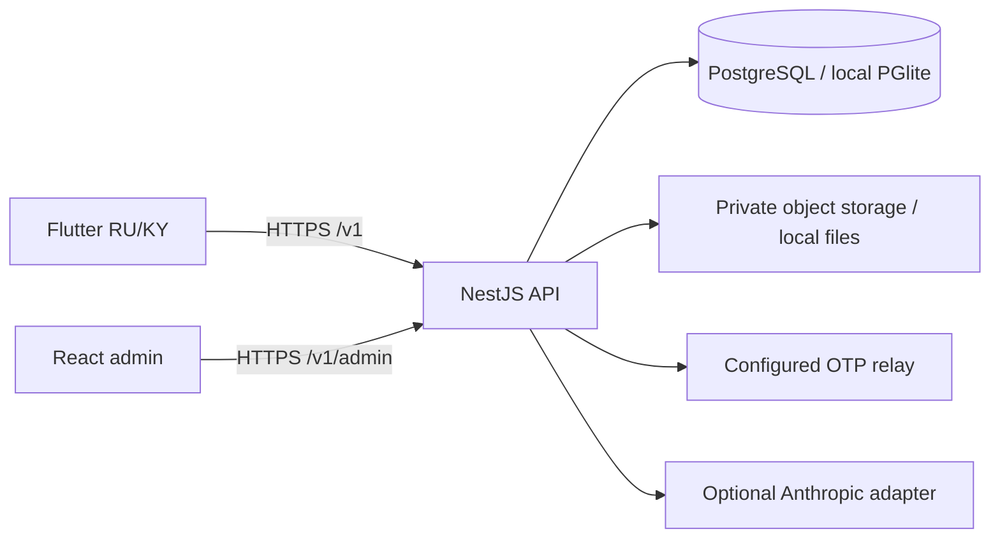

# Архитектура и приёмка

## Состав

`mobile` — Flutter с Riverpod и GoRouter. Сетевой слой Dio прикрепляет токен, передаёт язык и обновляет access token при 401. Токены хранятся в platform secure storage; в веб-версии безопасность зависит также от защищённого origin и защиты от XSS. SharedPreferences хранит язык, тему, общедоступный кэш и основные поля черновика. Скрытые признаки и байты изображений в этот черновик не записываются.

`backend` — модульный монолит NestJS. Контакты отделены от публичного профиля, скрытые признаки — от объявления, evidence — от сообщений. Drizzle описывает таблицы в `backend/src/database/schema.ts`; миграции лежат в `backend/drizzle`. PGlite предназначен для разработки, PostgreSQL — для production. Миграции и справочники применяются при запуске.

`admin` — React + Vite. Запросы `/v1/admin/*` проходят серверную проверку роли. Токен ограниченной длительности сохраняется в sessionStorage текущей вкладки. Интерфейс команды на русском; пользовательское приложение и сообщения сервера поддерживают RU/KY.

AI не подтверждает право собственности. Совпадения — рекомендации; владелец сравнивает признаки и принимает решение. Платформа не принимает и не переводит деньги. Чат имеет серверное разграничение доступа, но не сквозное шифрование.

## Сценарии и состояния

1. Гость проходит или пропускает знакомство, выбирает язык, просматривает каталоги. Для записи/общения появляется форма подтверждения контакта.
2. Нашедший выбирает категорию, фотографирует разрешённый предмет или заполняет данные вручную, указывает примерный район и скрытые признаки. Принимает правила и отправляет объявление.
3. Фото проходит ограничение размера, проверку формата, обработку sharp и удаление метаданных из публичного варианта. Ограниченные категории не получают публичной фотографии. Если автоматическая проверка недоступна, объявление переходит в `PENDING_REVIEW`.
4. Потерявший ищет вещь и подаёт приватную заявку с текстовыми подтверждениями. Самостоятельно смотреть скрытые признаки находки он не может.
5. Автор запрашивает уточнения, отклоняет либо подтверждает заявку. Подтверждение открывает общий диалог. Спор создаёт задачу модератору.
6. Стороны договариваются о передаче и подтверждают её в приложении. Код ограничен сроком и одноразовый. Завершение обновляет заявку и объявление; самостоятельная отметка о возврате не равна подтверждённому обеими сторонами возврату.
7. Жалоба поступает в панель команды. Решения, изменение статуса и административный доступ фиксируются в аудите.

Объявление: `DRAFT → PUBLISHED/PENDING_REVIEW → RESOLVED/CLOSED/REMOVED`. Заявка: `SUBMITTED/SCREENING → NEEDS_MORE_INFORMATION/PLAUSIBLE/REJECTED/UNDER_REVIEW → APPROVED_FOR_HANDOFF → COMPLETED`; возможен отзыв. Передача хранит подтверждение каждой стороны и состояние спора.

## Матрица приёмки

| Требование | Реализация | Проверка |
|---|---|---|
| Гостевой каталог | API и вкладки LOST/FOUND | API e2e, Flutter widget |
| Публикация без AI | Ручные поля, фото на модерацию | API e2e |
| Отсутствие геолокации | Район из справочника, координаты не требуются | API e2e |
| Конфиденциальные фотографии | Ограниченные категории, короткие приватные превью, контроль публичной выдачи | API e2e, включая отзыв публичного доступа |
| Приватность заявки | Автор объявления и заявитель; админ по роли | API e2e |
| Ограничение попыток | OTP/claims/chat rate limits | API e2e и unit |
| Реальная переписка | REST, история, дедупликация, WS на сервере | API e2e |
| Повтор публикации | Idempotency-Key для повторного запроса | API e2e; конкурентные запросы требуют дальнейшей проверки |
| Плохая сеть | Кэш ленты, основные поля черновика, повтор запроса | Flutter retry test; физическая сеть требует ручной проверки |
| Возврат | Одноразовый код и подтверждение сторонами | API e2e |
| Жалобы/модерация | Случаи и административные решения | API e2e |
| Удаление аккаунта | Обезличивание и отзыв доступа | API e2e |
| Тема и язык | RU/KY, light/dark/system | Flutter widget на узком экране |
| Сборка | Backend, admin, Flutter Web | Сборочные команды и CI |

## Разработка

Функциональные экраны лежат в `mobile/lib/features`; общий API-контракт и модели — в `core`. Все пользовательские подписи Flutter находятся в ARB; после правки переводов выполните `flutter gen-l10n`. Имена языков являются самоназваниями.

Для изменения схемы: правьте `schema.ts`, выполните `npm run db:generate` в backend, проверьте миграцию в отдельной БД и только затем обновляйте рабочую среду. Изменения API сопровождайте `npm run openapi:export` и `npm run test:e2e`. Не добавляйте рабочие объявления в seed.
